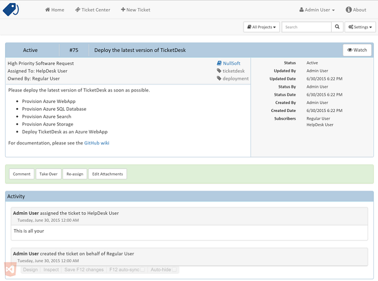

# TicketDesk, modernized

A modernization of [NullDesk/ticketdesk](https://github.com/NullDesk/ticketdesk) (TicketDesk 2.5, the issue tracker for IT
help desks by Stephen Redd and contributors) from .NET Framework to .NET 10. Upstream: <https://github.com/NullDesk/ticketdesk>.
TicketDesk is distributed under the Microsoft Public License ([`LICENSE.txt`](LICENSE.txt)), and so is this repository: the
attribution notices in the legacy sources are kept, and the pages, rules and texts ported into `src/modern` are derivative
works of TicketDesk 2.5. "TicketDesk" is the upstream project's name; this is an independent migration exercise, not a
release of TicketDesk and not endorsed by its authors. Documentation of TicketDesk itself: the upstream
[TicketDesk GitHub wiki](https://github.com/StephenRedd/TicketDesk/wiki).

This public repository is a single snapshot of the work (base: upstream `develop` as of 2022-01-03). The upstream history is
in the upstream repository; the migration's own history stayed private. In the evidence files, environment identifiers were
replaced before publication: Azure subscription, tenant, client, object, role-assignment and resource IDs, Azure DevOps IDs (`<subscription-id>`,
`<tenant-id>`, `<client-id-N>`, ...), the operator's IP address (`<home-ip>`), user names and home paths (`labuser`, `~`),
the host name (`lab-host`), the Azure DevOps organization (`<ado-org>`), the operator's university account (`<school-upn>`,
`University`), and an Azure Storage key, a search key and an Application Insights key that upstream had committed in
legacy config files (`<redacted-upstream-key>`). Nothing else in the evidence was changed. The well-known Azurite development key and the
antiforgery tokens in the replay recordings are lab-only values.

This fork migrates TicketDesk 2.5 (ASP.NET MVC 5 on .NET Framework, EF6, IIS, SQL Server Express) to .NET 10 (ASP.NET Core,
EF Core 10, Angular 22) while it keeps running: the old app served every route until the new one had taken it over, and
every step was checked against recorded behaviour of the old app. It is a lab project: one shared Linux host, the legacy app
in a Windows Server VM on that host, and a small Azure budget. Every number below comes from a run whose raw output is in
the repository.



## What was migrated, and how

- **Strangler fig.** The new app started as a gateway in front of the legacy app (YARP catch-all), and routes moved over in
  waves: each of the 89 rows of the route inventory ([`docs/migration/routes.csv`](docs/migration/routes.csv)) was switched
  in a watched registry file, so a route could go back to the legacy app within a second without a redeploy. Pages and the
  endpoints they post to moved together (their antiforgery tokens do not interchange); during coexistence both apps read
  one sign-in cookie (ASP.NET Core ticket format, read by the legacy OWIN app through Microsoft.Owin.Security.Interop, key
  ring in the database). In Round 4 the legacy app was retired: 80 routes are migrated, the other 9 (first-run setup, demo
  data, an anonymous e-mail test page) were dropped on purpose and answer 410/404 with a pointer to what replaces them; the
  gateway, the remote-authentication client, the shared cookie and the `Legacy` registry mode are gone
  ([`docs/dev/rollback.md`](docs/dev/rollback.md) says what rollback means now).
- **Characterization replay.** Before any route moved, 15 scripted journeys (262 HTTP exchanges) were recorded against the
  legacy app ([`tests/characterization/golden/`](tests/characterization/golden/)) and replayed against it again to prove the
  recording is stable. Every later change was replayed against that recording; a difference counts as intended only when it
  matches an entry of [`docs/migration/expected-differences.md`](docs/migration/expected-differences.md) (security fixes,
  legacy bugs, retired routes, the Angular pages, ...) through a narrow rule in
  [`docs/migration/replay-explanations.json`](docs/migration/replay-explanations.json); anything else is a regression.
- **Expand / contract schema changes.** Both apps shared one database, so schema changes are SQL scripts run by `td-db`
  ([`src/modern/TicketDesk.Database`](src/modern/TicketDesk.Database), journal `dbo.__ModernSchemaHistory`) as a deploy step:
  expand while the legacy app writes (e.g. `Tickets.AssignedDate` with a dual-write trigger, a batched backfill and online
  indexes), contract once it is gone (`td-db migrate --contract --legacy-retired`: trigger dropped, invariant enforced by a
  `CHECK` constraint). The rules and the run-time check against the real legacy app are in
  [`docs/sql/schema-changes.md`](docs/sql/schema-changes.md).
- **Identity.** ASP.NET Core Identity over the unchanged Identity 2 tables; Identity V2 password hashes while the legacy app
  could still verify them, V3 since its retirement (legacy hashes are rehashed at the next sign-in); Entra ID (OpenID Connect,
  app roles mapped to the legacy roles) as a second sign-in option; a least-privilege database login for the app.
- **Data and hosting.** Lift and shift of the legacy app to an Azure VM, then SQL Server Express to Azure SQL (BACPAC with a
  write freeze, per-table reconciliation as the go/no-go); the new app as non-root Linux containers for AKS (section Azure).
- **Front end, search, notifications.** Angular 22 replaces three pages (ticket center, ticket page, new ticket) behind the
  same registry, with switch-back to the server page; Lucene search moved to SQL Server full-text; e-mail notifications moved
  from an in-process timer with BinaryFormatter items to a Service Bus queue and a worker.

## Before and after

| | Before: TicketDesk 2.5 | After: this fork |
|---|---|---|
| Runtime | .NET Framework 4.6.2, ASP.NET MVC 5.2, OWIN, IIS on Windows | .NET 10, ASP.NET Core on Kestrel, Linux containers (chiseled, non-root) |
| Structure | 14 projects; controllers call EF6 contexts directly | modular monolith: Tickets, Projects, Users, Attachments, Search, Notifications, Settings, Reports modules + a web host and a worker |
| Data access | EF6 6.1.3: 23 code-based migrations, automatic migrations for two more contexts | EF Core 10 over the same schema; schema changes as `td-db` SQL scripts (expand / contract) |
| Database | SQL Server Express | SQL Server 2022 (lab container), Azure SQL; stored procedure for the ticket list, report procedures, filtered indexes |
| UI | Razor views, jQuery, Summernote, Dropzone, bundles | the same pages ported to ASP.NET Core Razor at the legacy URLs, plus Angular 22 for the three main pages |
| Identity | ASP.NET Identity 2.2 + OWIN cookie, V2 hashes, optional LDAP | ASP.NET Core Identity on the Identity 2 tables, V3 hashes with rehash, Entra ID (OIDC), key ring in the database |
| Search | Lucene.Net 3.0.3 index on the web server's disk | SQL Server full-text (`CONTAINSTABLE`) with the legacy field boosts |
| Notifications | in-process timer, BinaryFormatter push items, SMTP / SendGrid | Service Bus queue + `TicketDesk.Worker` (SMTP), retries and dead-lettering |
| Attachments | web server disk (the shipped Azure Blob provider did not work) | Azure Blob (Azurite locally) or a local folder, per-ticket authorization |
| Tests | none | xUnit (database, identity, modules, web, worker, tools), Vitest, Playwright, the golden replay |

## Numbers

All from [`docs/RESULTS.md`](docs/RESULTS.md) (one row per measured number, with its conditions); the evidence paths hold the
commands and raw output. Timings come from a shared lab host and vary from run to run, so comparisons use runs made back to
back.

| Metric | Value | Evidence |
|---|---|---|
| Routes | **80 of 89** inventory rows migrated, **9 retired** (410/404 with a pointer), 0 left on the legacy app | `docs/evidence/retire-20261110/replay-modern/migration-status.json` |
| Characterization recording | 15 journeys, 262 exchanges; replayed against the legacy app itself: 262 of 262 matched | `tests/characterization/golden/README.md`, `docs/evidence/baseline-20261108/replay-legacy/` |
| Golden replay against the new app alone | 258 compared: **87 matched, 177 explained, 0 unexplained** (4 more recorded hops explained: redirects that followed now-retired routes); every diff counted (Round 5b); Round 4, before the state-changing links became posts: 128 matched, 136 explained, 0 unexplained under td-replay's former 25-diffs cap (uncapped with its rules: 2 unexplained, F1) | `docs/evidence/followups-20261113/replay-modern/summary.md`, `docs/evidence/retire-20261110/replay-modern/summary.md` |
| Switch-back by registry edit (coexistence) | legacy answered 347 ms after the edit, the new app again 149 ms after the edit back | `docs/evidence/routes-20261108/switch-back/switch-back.txt` |
| p95 latency, legacy vs the new app alone | **87.1 → 39.4 ms** (p50 26.2 → 9.8 ms; medians of 5 interleaved back-to-back pairs, new app faster in 5 of 5), 0 % errors | `docs/evidence/retire-20261110/perf-legacy-vs-new/pairs.md` |
| Capacity at scale S, same 4 cores each for app + database (Round 6) | sustained in every repeat: legacy **10 ops/s**, the new app **150 ops/s** (k6 open model, Round 1 mix, p95 ≤ 500 ms and ≤ 0.5 % errors over 120 s); legacy stalls from 20 ops/s on (CLR thread-pool starvation), the new app breaks at 200 (page-lock contention on dbo.Tickets in the server-page ticket center); both knees move to the 4 cores' limit in a diagnostic (more pool threads: legacy 40; READ_COMMITTED_SNAPSHOT: new 200) | `docs/evidence/load-20261114/README.md` |
| Failure drills on kind at half capacity (Round 6) | web pod kill: 34 failed requests, recovered in **6.0 s** (2 replicas: 0); database egress cut: last 5xx 20 s after it ended; SQL restart: 5 s of 500s; worker killed mid-send 3 times: **0 notifications lost**, 3 sent twice (at least once) | `docs/evidence/load-20261114/drills.md` |
| Restore drill on kind (Round 6) | **RTO 16.9 s**, **RPO 17.2 s** (medians of 3 / 4 runs; full + 30 s log backups, the database dropped, point-in-time restore, app switched through a values file) | `docs/evidence/load-20261114/restore-drill/summary.md` |
| Ticket list at 1,000,000 tickets, naive port vs tuned | 146 → 51 ms warm median, 214,548 → 3,326 logical reads | `docs/evidence/sql-compare-20261107/compare-naive-vs-tuned.md` |
| Assignee workload report at 1,000,000 tickets | 6,322 → 64 ms, 22,295,977 → 19,096 logical reads (expand column instead of event scans) | `docs/evidence/sql-compare-20261107/compare-naive-vs-tuned.md` |
| Expand / contract at 1,000,000 tickets | backfill of 895,163 rows 7.03 s; contract (C0001) 0.40 s, 0 rows breaking the new constraint | `docs/evidence/sql-after-20261107/migrate-L.txt`, `docs/evidence/retire-20261110/contract-copy-L/` |
| Data-migration downtime, SQL Server Express → Azure SQL | write freeze **76.2 s**; 0 of 172 reads failed, 47 of 120 writes failed (all inside the freeze); 20 of 20 tables reconciled | `docs/evidence/azure-sql-20261110/cutover-measured-20261110T081515Z/` |
| Rebuild from zero, legacy on an Azure VM (lift and shift) | 1,236 s from nothing billable (only the Entra app) to a passing smoke test | `docs/evidence/azure-lift-20261108/rebuild-20261108T205254Z/rebuild.txt` |
| Accessibility of the three replaced pages | Lighthouse 65 / 71 / 67 → **100 / 100 / 100**; axe-core 26 rule violations on 133 nodes → **0** | `docs/evidence/angular-20261110/frontend/comparison.md` |
| Angular initial bundle | 296,453 B raw, 94,435 B served (Brotli) | `docs/evidence/angular-20261110/bundle/files.csv` |
| Internal-user search at 1,000,000 tickets | 1,033,583 → 111,365 logical reads with a subscriber index | `docs/evidence/search-worker-20261110/subscriber-index-L/README.md` |
| Ticket text rendering after replacing HtmlSanitizer 3.2 (4 advisories) | 55,810 of 55,829 texts byte-equal, the 19 others equivalent (same DOM) | `docs/evidence/tickets-20261110/sanitizer/report.md` |
| Vulnerable packages after the retirement | none in the 28 projects of the solution; no YARP or System.Web adapters package left in the web host | `docs/evidence/retire-20261110/packages/` |
| Notifications while both apps wrote | 11 mails, all expected, 0 sent twice | `docs/evidence/search-worker-20261110/notification-coexistence-run2/README.md` |
| Tests | .NET **729 passed** (741 before the retirement; 25 gateway tests went with the gateway), Vitest 28; Playwright 10 tests, **3 runs 10/10** | `docs/evidence/retire-20261110/tests/before-after.md`, `docs/evidence/retire-20261110/e2e/runs.txt` |

## Run it locally

Linux or macOS with the .NET 10 SDK, Node.js 24 (for the Angular build) and Docker. The scripts under `ops/dev/` keep
passwords in `$TD_W/.secrets/` (created on first use, never printed); `TD_W` defaults to `~/Desktop/ticketdesk-modernization`
(the repository is `$TD_W/ticketdesk`) and `$TD_W/.tools/env.sh` puts the toolchain on `PATH`.

```bash
. "$TD_W/.tools/env.sh"                              # .NET 10, Node 24, sqlcmd (or put your own on PATH)
cd "$TD_W/ticketdesk"
ops/dev/td-sql.sh build-image && ops/dev/td-sql.sh up  # SQL Server 2022 + Full-Text Search on 127.0.0.1:14333

# a database: the TicketDesk 2.5 schema with synthetic data (250 users, 10,000 tickets), then the new app's schema
TD_SEED_DB=TicketDeskDev ops/dev/seed.sh schema --create-database
TD_SEED_DB=TicketDeskDev ops/dev/seed.sh run --scale S
dotnet build src/modern/TicketDesk.Database -c Release
TD_DB_CONN="$(ops/dev/td-sql.sh conn TicketDeskDev)" \
  src/modern/TicketDesk.Database/bin/Release/net10.0/td-db migrate --contract --legacy-retired

# the app (the build runs the Angular build when src/web changed), on http://127.0.0.1:5080
TD_MODERN_DB=TicketDeskDev ops/dev/run-modern.sh
```

An empty installation instead of synthetic data: `ops/dev/seed.sh schema --create-database` and `td-db migrate --contract
--legacy-retired` as above, then the first administrator (the retired first-run setup's step), with the password on standard
input or in a file, never on the command line:

```bash
TD_DB_CONN="$(ops/dev/td-sql.sh conn TicketDeskDev)" src/modern/TicketDesk.Database/bin/Release/net10.0/td-db \
  create-admin --email you@example.org --display-name "Your Name" --password-file ~/td-admin-password   # or --password-stdin
```

Sign in with a seeded account, e.g. `aria.thomas.00004@seed.ticketdesk.test` (an administrator) and the password in
`$TD_W/.secrets/td-seed.env`. `td-seed schema` also creates the legacy app's push-notification tables (`notifications.*`,
which the legacy app created by automatic EF6 migrations; in the script since Round 5b, so new users and their e-mail
destination work on an empty or synthetic database).

Tests:

```bash
export TD_SQL_TEST_CONN="$(ops/dev/td-sql.sh conn master)"
dotnet test --solution src/modern/TicketDesk.Modern.sln -c Release     # tests needing lab data or emulators skip (lab: 649 passed, 80 skipped)
(cd src/web && npm ci && npm test)                                     # Vitest
```

The full suite (772) also needs `TD_MODERN_SEEDED_DB=TicketDesk` (the restored lab data or a `TicketDesk_*` copy of it),
`TD_SEED_USER_PASSWORD`, Azurite (`TD_AZURE_STORAGE_CONNECTION_HOST`) and the Service Bus emulator
(`TD_SERVICEBUS_TEST_CONN="$(ops/dev/servicebus-emulator.sh conn)"`). With the lab data and secrets in place:
`ops/dev/replay-modern.sh --from tests/characterization/golden/legacy-golden.jsonl.xz --out-dir DIR` replays the golden
recording against the new app alone, `ops/dev/e2e.sh --out-dir DIR` runs the Playwright suite, and
`docker build -f src/modern/TicketDesk.Web/Dockerfile .` builds the image (after `npm --prefix src/web ci && npm --prefix
src/web run build`; 276.8 MB, non-root, `docs/evidence/retire-20261110/container/`). Every deployment runs
`td-db migrate --contract --legacy-retired` before the new image: this build needs the contracted schema.

## Limits

- **Entra ID sign-in with a real account: once, on a local run.** On 2026-11-25 a real person signed in through Entra ID
  in the operator's own tenant; the first sign-in created the user and mapped its Entra app role to the legacy role
  (`docs/evidence/entra-signin-20261125/`). That was one account on the app run locally (`ops/dev/entra-local.sh`), not
  on AKS; the other roles and sign-out are proven against the local OpenID Connect test provider only. The earlier attempt
  in the university tenant was blocked by its consent policy (`AADSTS65004`).
- **CI/CD on one self-hosted agent.** The pipelines run in a private Azure DevOps project on a single agent on the lab
  host; the lab secrets stay on that host (read per value and masked), not in an Azure DevOps variable group. CD to AKS
  ran once (run 34, in the 2026-11-12 Azure session). At the end of the project (2026-11-12) the service connection,
  both Entra apps and the kind CD cluster were removed: CD needs them recreated before it deploys again; CI still runs.
- **A lab, not production.** One shared host (other projects run on it), the legacy app in a 4-vCPU VM on that host, the
  Azure parts in short unattended sessions on a student subscription with a $15 budget. Timings move from run to run (the
  same legacy snapshot measured 53.7 to 95.0 ms p95), so before/after claims use runs made back to back, interleaved.
- **The load comparison is the app tier only, on lab hardware.** In the legacy-vs-new pairs both apps use the same SQL
  Server Express in the VM; the legacy app runs in the VM (4 vCPU), the new app on the host pinned to 4 cores. The mix is
  the Round 1 one (server-rendered pages); it does not exercise the Angular pages, attachments or search.
- **Capacity (Round 6)** gives each system 4 E-cores for app and database together (legacy: the VM with its SQL Express;
  new: the app and a SQL Express container) at scale S; the new app ran its server pages, not the shipped Angular pages,
  and its knee is that path's own count query; at 1,000,000 tickets only the new app was loaded (the server-page ticket
  center does not hold 5 ops/s there, the API list path holds 50). The failure and restore drills ran on kind, not AKS.
- **Scale.** The app-level numbers are at scale S (10,000 tickets, 250 users); the SQL tuning numbers at scale L (1,000,000
  tickets) on the lab container.
- **Not replaced when the legacy app was retired**: the TicketDesk 2.0 upgrade path, SendGrid and notification consolidation
  (SMTP, one mail per write). The first-run setup's first administrator is `td-db create-admin` since Round 5.
- **Search ranks differently** (SQL Server full-text instead of Lucene): for the two recorded queries 18 and 12 of the
  legacy top 20 are in the new top 20.
- **Users signed in when the legacy app was retired sign in once more** (the shared cookie of the coexistence rounds is not
  read any more).

## CI/CD

Azure DevOps (private project), one self-hosted agent on the lab host.

- **CI** (`azure-pipelines/ci.yml`) gates every PR into `modernize`: the branch policy requires the build, and direct pushes
  are refused. It runs Terraform fmt/validate, the NuGet and npm vulnerability audits, Angular Vitest and build, the .NET
  build and tests with coverage, Playwright E2E, the golden replay against the new app alone, and the container images.
  Per run: .NET 741 tests, Vitest 28, Playwright 10; succeeded runs took 141–202 s (median 169 s).
- **Gates:** three demo PRs (a failing test, a vulnerable package, `terraform fmt` drift) were blocked, then completed after
  the fix.
- **CD** (`azure-pipelines/cd.yml`) starts when CI on `modernize` succeeds and deploys through two environments, each with a
  manual approval: a local kind cluster (`kind-local`; runs 33 and 37 deployed and passed their smoke) and the lab AKS
  (`aks-lab`; run 34 deployed v2 in the 2026-11-12 Azure session). Azure access goes only through a workload-identity
  service connection, with no secret.

Evidence: [`docs/evidence/pipelines-20261111/`](docs/evidence/pipelines-20261111/) and the CI/CD rows of
[`docs/RESULTS.md`](docs/RESULTS.md).

## Azure

The Azure parts ran as short unattended sessions on a student subscription (swedencentral), each starting from an empty
resource group and destroying it at the end; a cron reaper deletes the group at its ttl if a session's own destroy never
runs.

- **Before AKS:** the legacy app lifted to a Windows VM, then its database moved from SQL Server Express to Azure SQL under
  a write freeze (rows in [`docs/RESULTS.md`](docs/RESULTS.md)).
- **AKS:** the first session (2026-11-11) stopped at its first apply (no VM capacity in the region). The rerun (2026-11-12)
  rebuilt everything from zero: the VM, then AKS; cutover from the VM to AKS; certificate rotations on both; the VM
  retired; v2 deployed through the Azure DevOps CD pipeline after the user's approval; the alert drill and the SLO queries.
  19 of its 20 steps passed.
- **What did not work:** the load balancer's health probe was blocked by the AKS subnet's own NSG and was fixed by hand
  during the session (the rule is now in Terraform); v1 went NotReady while v2 waited for its approval (fixed in the chart,
  checked on kind only, not on AKS); the restore drill restored the database but could not switch the app to it, so RTO
  and RPO were not measured there (the fixed path, measured on kind in Round 6: RTO 16.9 s, RPO 17.2 s); the golden replay's drift on AKS is not classified.
- **Cost:** tracked in a conservative ledger because the subscription's cost API returns nothing: running estimate $14.72
  of the $15 budget ([`docs/dev/azure-spend.md`](docs/dev/azure-spend.md)).

Runbook: [`docs/dev/azure-aks.md`](docs/dev/azure-aks.md). Numbers and their conditions: the AKS rows of
[`docs/RESULTS.md`](docs/RESULTS.md). Raw output: [`docs/evidence/aks-20261112/`](docs/evidence/aks-20261112/) (the rerun)
and [`docs/evidence/aks-20261111/`](docs/evidence/aks-20261111/) (the first session and the local proofs).

## Repository layout

| Path | What |
|---|---|
| `TicketDesk/` | the legacy app (upstream code; changes only for coexistence and the Azure moves: .NET Framework 4.8, System.Web adapters server, shared cookie, Blob store wrapper, managed-identity token for Azure SQL) |
| `src/modern/` | the new app: `TicketDesk.Web` (host), `Modules/*`, `TicketDesk.Data`, `TicketDesk.Identity`, `TicketDesk.Database` (`td-db`), `TicketDesk.Worker`, tests |
| `src/web/` | the Angular front end and its Playwright suite |
| `tools/` | `td-replay` (record / replay / compare), `td-seed` (synthetic data), a test OpenID Connect provider |
| `docs/` | `RESULTS.md`, `migration/` (inventory, routes, expected differences), `sql/`, `dev/`, `evidence/` |
| `ops/`, `infra/` | lab scripts (local VM, Windows provisioning, Azure sessions) and Terraform |
| `tests/` | the golden recording and the k6 load mix |
